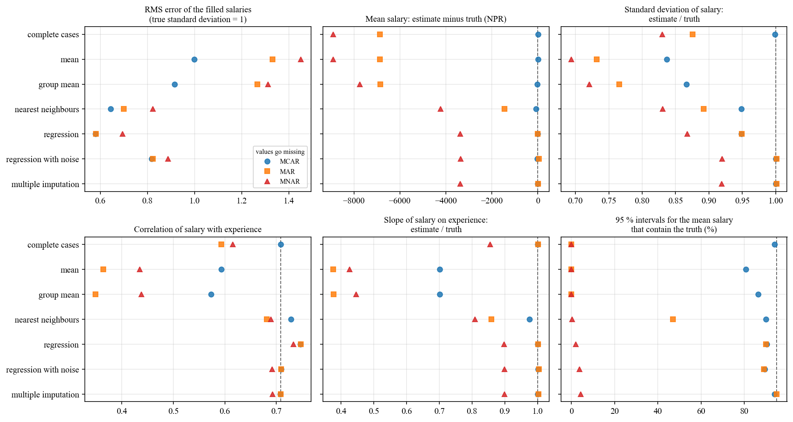
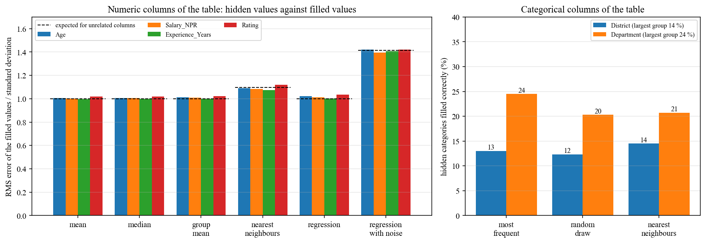
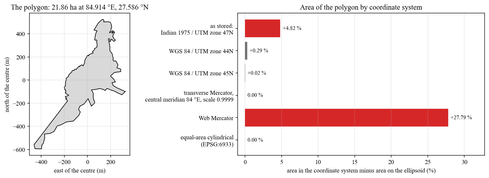
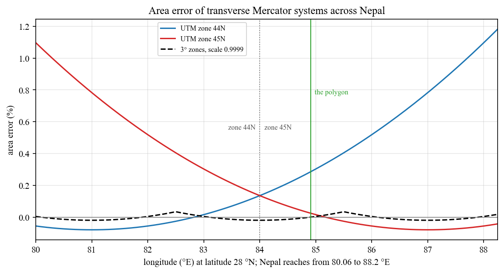

# Preprocessing studies: filling missing values, and areas in map coordinate systems

Python code for two questions that the first notebooks of this repository met and did not
answer:

1. A table has gaps. What does each way of filling them do to the numbers computed from the
   table afterwards?
2. A polygon has an area. How wrong is that area when it is computed in the wrong coordinate
   system?



## Data and its limits

**Staff table.** `data/dataset_nepali.csv` has 1,000 rows with name, age, district, salary,
department, years of experience, rating and join date. 202 values are missing, 29 to 41 in each
of six columns (3.4 % of those cells), and 816 rows are complete
([figure](figures/table_missing.png)).

The table is generated, not a record of staff:

- the join dates are one per day from 1 January 2000, in the order of the rows;
- the years of experience are more than the age in 101 of the 937 rows that have both;
- every numeric column is spread evenly over its range, and no two of the six columns are
  related: of 15 tests the smallest p-value is 0.040, which is 0.60 after Holm's adjustment
  for 15 tests, and the largest rank correlation is 0.067;
- whether a value is missing does not depend on the other columns: of 30 tests 3 have a p-value
  below 0.05, where 1.5 are expected by chance, and the smallest is 0.16 after Holm's
  adjustment.

A table without relations cannot show what filling does to relations, and no method can fill
its gaps better than the column mean does. The table is used to show exactly that; the effects
of the methods are measured on simulated tables whose relations are known.

**Polygon.** `data/new_shapefile.shp` holds one polygon of 279 vertices that the first version
copied from a folder of GIS training data. The file declares the coordinate system Indian 1975 /
UTM zone 47N (EPSG:24047), which is made for Thailand and has its central meridian at 99 °E.
Read with that system the polygon lies at 84.914 °E, 27.586 °N in central Nepal, 14.1° west of
that meridian, and covers 21.86 ha.

**Countries.** `data/countries_110m.gpkg` holds 177 country outlines of Natural Earth at
1:110 million (public domain). The first notebooks loaded this layer through
`geopandas.datasets`, which geopandas 1.0 no longer has. The outlines are coarse; the study
uses ratios between areas of the same outline, not the areas themselves.

## Method

**Missing values** (`prep/table.py`, `prep/simulate.py`, `prep/impute.py`)

1. **Checks of the table.** Every pair of columns is tested for a relation (rank correlation
   for two numeric columns, Kruskal-Wallis for a numeric and a categorical one, a permuted
   chi-square test for two categorical ones), and every incomplete column is tested for whether
   its gaps depend on the values of another column. The p-values are adjusted by Holm (1979).
2. **Ways of filling a numeric column.** Mean; median; mean of the department; mean of the 5
   nearest rows (Troyanskaya et al., 2001); regression on all other columns, one column after
   the other (van Buuren and Groothuis-Oudshoorn, 2011); and regression with noise, which adds
   to the prediction a draw of the scatter around the line and of the uncertainty of the line
   (van Buuren, 2018, algorithm 3.1). Multiple imputation fills the table 20 times by
   regression with noise and pools the 20 results by the rules of Rubin (1987).
3. **Ways of filling a category.** The most frequent value; a random draw from the known
   values; the vote of the 15 nearest rows.
4. **Hiding known values of the table.** 10 % of the known values are hidden at random and
   filled back, 20 times. The error is the RMS difference between hidden and filled values in
   units of the standard deviation of the column.
5. **Simulated tables.** 1,000 staff aged 22 to 59. Experience is a random share of the years
   since the age of 21. The monthly salary is 35,000 NPR plus 2,200 NPR per year of experience,
   plus a difference by department of -10,000 to +20,000 NPR, plus normal noise with a standard
   deviation of 15,000 NPR. The rating is unrelated to the rest. 30 % of the salaries then go
   missing in one of three ways (Rubin, 1976):
   - **MCAR**, completely at random: every salary with the same probability;
   - **MAR**, at random given what is observed: more often for staff with long experience;
   - **MNAR**, not at random: more often for high salaries.

   For each way 300 tables are made. From each filled table the mean and standard deviation of
   the salary, its correlation with experience and the slope of salary on experience are
   computed and compared with the true values, and a 95 % interval for the mean salary is
   computed as if the filled values had been observed.

**Areas** (`prep/areas.py`)

1. **Reference.** The area of an outline on the WGS 84 ellipsoid, by the geodesic method of
   Karney (2013) as implemented in PROJ.
2. **Area in a coordinate system.** The outline is projected and its plane area is divided by
   the reference. For the countries, vertices are first added along the outlines so that none
   are more than 0.1° apart; an edge is then the same line in every system.
3. **Systems.** UTM zones 44N and 45N; a transverse Mercator system with 3° zones and scale
   0.9999, the layout of Nepal's national grid (PROJ lists its 84° zone as ESRI:102306), here
   on the WGS 84 ellipsoid; Web Mercator; and an equal-area cylindrical projection (EPSG:6933).
4. **Area factor at a point.** For the transverse Mercator systems from PROJ. For Web Mercator
   from the scale along the parallel and along the meridian (Snyder, 1987): the factor is
   (1 - e² sin² φ)² / ((1 - e²) cos² φ) at latitude φ, close to 1 / cos² φ.

## Results

Produced by `python run_analysis.py`; all tables are in [results/summary.md](results/summary.md).

### The table: nothing to gain from a better method

RMS error of the filled values, in standard deviations of the column (range over the four
numeric columns):

| Method                               | Error        | Expected when columns are unrelated |
| ------------------------------------ | ------------ | ----------------------------------- |
| mean, median, mean of the department | 1.00 to 1.02 | 1                                   |
| regression                           | 1.00 to 1.04 | 1                                   |
| 5 nearest rows                       | 1.08 to 1.12 | √(1 + 1/5) = 1.10                   |
| regression with noise                | 1.40 to 1.42 | √2 = 1.41                           |

Hidden categories are filled correctly as often as the largest group is large: the most
frequent value is right for 13.0 % of the districts and 24.5 % of the departments (the largest
groups hold 13.8 % and 23.8 %), a random draw for 12.3 % and 20.3 %, and the nearest rows for
14.5 % and 20.7 %. Filling every gap with the most frequent value raises the share of Bhaktapur
from 13.8 % to 17.3 % and that of Finance from 23.8 % to 26.0 %.



### Simulated tables: what filling does when columns are related

True values: mean salary 64,561 NPR, standard deviation 25,977 NPR, correlation with experience
0.708. The last column is the share of the 95 % intervals that contain the true mean; with 300
tables a share of 95 % has a standard error of 1.3 points.

Salaries missing completely at random (MCAR):

| Method                 | Error of the filled values (SD) | Mean minus truth (NPR) | SD / truth | Correlation | Slope / truth | Intervals with the truth |
| ---------------------- | ------------------------------- | ---------------------- | ---------- | ----------- | ------------- | ------------------------ |
| complete rows only     | -                               | +5                     | 1.00       | 0.709       | 1.00          | 94 %                     |
| mean                   | 1.00                            | +5                     | 0.84       | 0.593       | 0.70          | 81 %                     |
| mean of the department | 0.92                            | -25                    | 0.87       | 0.573       | 0.70          | 86 %                     |
| 5 nearest rows         | 0.64                            | -86                    | 0.95       | 0.729       | 0.98          | 90 %                     |
| regression             | 0.58                            | -6                     | 0.95       | 0.747       | 1.00          | 90 %                     |
| regression with noise  | 0.82                            | -17                    | 1.00       | 0.709       | 1.00          | 89 %                     |
| multiple imputation    | -                               | -12                    | 1.00       | 0.708       | 1.00          | 94 %                     |

Salaries missing more often for staff with long experience (MAR):

| Method                 | Error of the filled values (SD) | Mean minus truth (NPR) | SD / truth | Correlation | Slope / truth | Intervals with the truth |
| ---------------------- | ------------------------------- | ---------------------- | ---------- | ----------- | ------------- | ------------------------ |
| complete rows only     | -                               | -6,873                 | 0.88       | 0.594       | 1.00          | 0 %                      |
| mean                   | 1.33                            | -6,873                 | 0.73       | 0.364       | 0.38          | 0 %                      |
| mean of the department | 1.27                            | -6,861                 | 0.77       | 0.348       | 0.38          | 0 %                      |
| 5 nearest rows         | 0.70                            | -1,452                 | 0.89       | 0.682       | 0.86          | 47 %                     |
| regression             | 0.58                            | +1                     | 0.95       | 0.747       | 1.00          | 90 %                     |
| regression with noise  | 0.82                            | +38                    | 1.00       | 0.709       | 1.00          | 89 %                     |
| multiple imputation    | -                               | +18                    | 1.00       | 0.709       | 1.00          | 95 %                     |

- **Filling with the mean keeps the mean and damages the rest.** With 30 % of the values at the
  mean, the standard deviation falls to 0.84 of the truth (√0.7), the correlation with
  experience from 0.71 to 0.59 and the slope to 0.70. The interval for the mean is too narrow
  and contains the truth in 81 % of the tables.
- **The method with the smallest error is not the one that keeps the table intact.** Regression
  has the smallest error of the filled values, 0.58, but puts every filled value on the line:
  the standard deviation is 5 % too small and the correlation too large (0.747). Adding noise
  raises the error to 0.82 and gives back the standard deviation and the correlation.
- **One filled table is not data.** Regression with noise gets every estimate right, and its
  interval still contains the truth in 89 % of the tables, because the filled values are
  counted as observed. Pooling 20 filled tables gives 94 to 95 %.
- **When the gaps depend on another column, leaving rows out is biased.** Under MAR the mean
  salary of the complete rows is 6,873 NPR (10.6 %) too low, and filling with the mean does not
  change that. The regression methods remove the bias because experience is in the model.
- **When the gaps depend on the missing value itself, nothing here helps.** Under MNAR the
  complete rows are 8,897 NPR too low and the regression methods 3,354 to 3,381 NPR; their
  intervals contain the truth in at most 4 % of the tables. A table cannot show that its gaps
  are of this kind, because that would take the missing values.

### The polygon



| Coordinate system                                         | Area (m²) | Difference from the area on the ellipsoid |
| --------------------------------------------------------- | --------- | ----------------------------------------- |
| as stored: Indian 1975 / UTM zone 47N                     | 229,175   | +4.82 %                                   |
| WGS 84 / UTM zone 44N                                     | 219,262   | +0.29 %                                   |
| WGS 84 / UTM zone 45N                                     | 218,684   | +0.02 %                                   |
| transverse Mercator, central meridian 84 °E, scale 0.9999 | 218,630   | 0.00 %                                    |
| Web Mercator                                              | 279,381   | +27.79 %                                  |
| equal-area cylindrical (EPSG:6933)                        | 218,629   | 0.00 %                                    |

The area on the ellipsoid is 218,630 m². The coordinates as stored give 229,175 m², 4.82 % too
much, because the polygon is 14.1° from the central meridian of its system. In UTM zone 45N,
the zone it lies in, the difference is 0.02 %.

### Countries and Nepal

- **Degrees are not an area unit.** One square degree is between 2,046 and 12,305 km² for the
  177 outlines, and 10,875 km² for Nepal.
- **Web Mercator** enlarges every country: by a factor of 1.007 (Gabon) to 16.4 (Greenland),
  1.29 for Nepal ([figure](figures/countries_web_mercator.png)). Antarctica is left out because
  it reaches beyond the latitudes that the projection shows.
- **One UTM zone for the whole world**, as in the first notebook, gives areas within 1 % for
  six outlines: Nepal, Bhutan and Bangladesh near the zone, and Guatemala, Belize and El
  Salvador on the opposite side of the globe. 98 outlines are off by more than half, the
  largest by a factor of 83 (Ecuador), and five cannot be computed.
- **The equal-area projection** is within 0.0013 % for every outline.
- **Across Nepal** at latitude 28 °N, UTM zone 45N is 1.08 % too large at the western end of the
  country (80.06 °E) and zone 44N 1.17 % at the eastern end (88.20 °E). With the zone chosen by
  longitude the error is between -0.08 % and +0.13 %; with 3° zones and scale 0.9999 it is
  between -0.02 % and +0.03 %. Web Mercator is 28.8 % too large.



## Running

```
pip install -r requirements.txt
python run_analysis.py              # about one and a half minutes; writes results/ and figures/
python -m unittest discover -s tests
```

The random numbers come from one seed in `run_analysis.py`, so a run gives the same tables again.

## Layout

```
prep/table.py        the staff table: missing values, relations between columns, consistency
prep/simulate.py     staff tables with known relations; three ways for values to go missing
prep/impute.py       the ways of filling, the masking experiment, the simulation, Rubin's rules
prep/areas.py        area on the ellipsoid, area in a coordinate system, area factors
run_analysis.py      both studies; writes results/summary.json, results/summary.md and figures/
tests/test_prep.py   18 tests against known answers
data/                the staff table, the polygon and the country outlines
legacy/              the five notebooks of the first version
```

## Changes from the first version

The first version was five notebooks that followed tutorials. They counted the missing values
of the table, drew them, deleted a column and the incomplete rows, and filled categories with
the most frequent value and numbers with the mean. For the map data they computed areas,
centroids and buffers of countries in degrees, converted all countries to UTM zone 45N and
wrote the polygon to a shapefile. They are kept unchanged in `legacy/`; their paths point to
the old places of the files and to folders outside the repository.

- Each step of the notebooks now has a measured consequence: what filling with the mean or the
  most frequent value does to a table, and how large the area error is in each system.
- The methods are tested on cases with known answers.
- One command reproduces every number and figure, and all data are in the repository.

## Limits

- In the simulated tables the salary follows a straight line with normal noise, which is the
  form that the regression methods assume. Where the relation has another form they do worse
  than here.
- Only the salary has gaps in the simulation, always 30 %, with one strength of the dependence.
  The nearest-rows method uses 5 rows and one distance and is not tuned.
- The intervals for the single filled tables treat the filled values as observed, as an
  analysis of a filled table would by default.
- The staff table is generated, so nothing follows from it about staff.
- The reference area is that on the ellipsoid; height and relief of the ground are not
  included.
- The position of the polygon rests on the coordinate system declared in its file and on a
  datum shift defined for Thailand. It was not checked against a map. The area ratios do not
  depend on it noticeably.
- The 3° system is computed on the WGS 84 ellipsoid, not on the Everest 1830 ellipsoid of
  Nepal's national grid.

## References

- Holm, S. (1979). A simple sequentially rejective multiple test procedure. Scandinavian
  Journal of Statistics 6, 65-70.
- Karney, C. F. F. (2013). Algorithms for geodesics. Journal of Geodesy 87, 43-55.
  https://doi.org/10.1007/s00190-012-0578-z
- Natural Earth. 1:110m cultural vectors, countries. https://www.naturalearthdata.com/
- Rubin, D. B. (1976). Inference and missing data. Biometrika 63, 581-592.
  https://doi.org/10.1093/biomet/63.3.581
- Rubin, D. B. (1987). Multiple Imputation for Nonresponse in Surveys. Wiley.
  https://doi.org/10.1002/9780470316696
- Snyder, J. P. (1987). Map projections: A working manual. U.S. Geological Survey Professional
  Paper 1395. https://doi.org/10.3133/pp1395
- Troyanskaya, O. and others (2001). Missing value estimation methods for DNA microarrays.
  Bioinformatics 17, 520-525. https://doi.org/10.1093/bioinformatics/17.6.520
- van Buuren, S. (2018). Flexible Imputation of Missing Data, 2nd edition. Chapman & Hall/CRC.
  https://stefvanbuuren.name/fimd/
- van Buuren, S. and Groothuis-Oudshoorn, K. (2011). mice: Multivariate imputation by chained
  equations in R. Journal of Statistical Software 45(3). https://doi.org/10.18637/jss.v045.i03

## Author

Bibek Subedi, 078bce035.bibek@pcampus.edu.np
